<picture>
  <source media="(prefers-color-scheme: dark)" srcset="./assets/hero-dark.svg">
  <source media="(prefers-color-scheme: light)" srcset="./assets/hero-light.svg">
  
</picture>

  <a href="https://www.linkedin.com/in/andrea-salemi-87b8141bb"><b>LinkedIn</b></a>
  &nbsp;·&nbsp;
  <a href="mailto:andrea.salemi99@hotmail.com"><b>Email</b></a>
  &nbsp;·&nbsp;
  <a href="./Andrea_Salemi_CV.pdf"><b>CV (PDF)</b></a>

## About

I'm a **Full-Stack Software Engineer** at [Efebia](https://github.com/efebia-com) in Turin, Italy, with **5+ years** of building production web and mobile apps in **TypeScript**: React, Next.js, Svelte and SvelteKit on the frontend, Node.js (Fastify, NestJS) and PostgreSQL on the backend.

- 🧩 **Design systems.** I led a 15-person Frontend team and a 4-person UX/UI team in building a Figma-to-code design system on shadcn/ui, now used in every company project.
- ⚡ **Real-time products.** Live auctions over WebSockets, streaming of multi-GB 3D BIM models, Web3 apps on VeChain and Base.
- 🤖 **Agentic coding.** I work with Claude Code using multi-agent workflows plus custom skills and rules, which keeps code-review time low and gets correct code to production faster.

> [!NOTE]
> Most of my work lives in private client repositories, so instead of code links you'll find short case studies below. I'm happy to walk through any of them.

## Selected work

<table>
<tr>
<td width="50%" valign="top">

### ⚡ Real-time B2B auction platform
TypeScript monorepo with a Fastify 5 REST API on Drizzle ORM and PostgreSQL, plus three React 19 SPAs (dealers, buyers, admin CMS) for a B2B user base of **1,000–5,000 users**.

- Live ascending auctions over WebSockets with anti-sniping extensions
- Event-driven auto-bid engine on PostgreSQL row locking (`FOR UPDATE SKIP LOCKED`)
- API calls optimized with TanStack Query and smart cache invalidation

`React 19` `TanStack Query` `Fastify` `Drizzle` `PostgreSQL` `WebSockets` `Stripe` `AWS CDK`

</td>
<td width="50%" valign="top">

### 🏗️ 3D BIM viewer for construction
SvelteKit frontend that renders IFC models, backed by a NestJS service that delivers **2–5 GB** files through streaming or full download.

- Streaming plus preprocessing cut model load times by **80%**
- Real-time processing progress over WebSockets (pub/sub)
- Role-based access control for IFC projects and files

`SvelteKit` `NestJS` `MongoDB` `PostgreSQL` `WebSockets` `IFC / BIM`

</td>
</tr>
<tr>
<td width="50%" valign="top">

### 🧩 Company-wide design system
Unified design system between Figma and the frontend codebase, built on shadcn/ui and its component-driven approach, for every web and mobile app at Efebia.

- Led the Frontend team (**15 people**) and the UX/UI team (**4 people**)
- Standard project templates on TanStack Start (React) and SvelteKit
- Both adopted by **every company project** since their introduction

`shadcn/ui` `Figma` `Tailwind CSS` `TanStack Start` `SvelteKit`

</td>
<td width="50%" valign="top">

### 🎵 Decentralized music platform
DeFi platform on Base (Ethereum L2) that removes intermediaries from the music industry. I architected and led the frontend, including the Web3 experience for smart-contract interactions.

- Lead Frontend Developer
- The project raised **$1M at a $19.37M valuation**

`SvelteKit` `TypeScript` `Web3` `Base L2`

</td>
</tr>
<tr>
<td width="50%" valign="top">

### 📚 Zipaki: comics & manga reader
Reader app at [zipaki.com](https://zipaki.com) with community, discovery and in-app purchases, shipped on iOS and Android from a single web codebase.

- Full frontend architecture for every user flow
- Download service that handles every download state, so content is always readable

`SvelteKit` `Capacitor` `TypeScript` `iOS` `Android`

</td>
<td width="50%" valign="top">

### 🛒 Magento → Shopify migration
Technical Lead on moving two publishers' stores (J-POP Manga & Edizioni BD) from Magento 2 to Shopify, live since October 2026.

- Product tag taxonomy that powers site search and customer segmentation
- Email automations for about 19,000 customers at **86–89% lower cost** than premium platforms

`Shopify` `Shopify Flow` `Matrixify` `Magento 2`

</td>
</tr>
</table>

**Also:** EcoMeal for VeChain (Svelte app migrated to **React Native**) · Checksig, a crypto asset app for web, iOS and Android · vorj.io, a Web3 no-code platform (React, Next.js, RBAC) · the Efebia website with interactive 3D (Threlte / Three.js).

## Tech stack

<picture>
  <source media="(prefers-color-scheme: dark)" srcset="./assets/stack-dark.svg">
  <source media="(prefers-color-scheme: light)" srcset="./assets/stack-light.svg">
  
</picture>

**Languages:** TypeScript, JavaScript, SQL · **Frontend:** React, Next.js, Svelte, SvelteKit, TanStack (Start, Router, Query), Tailwind CSS, shadcn/ui, Vite · **Backend:** Node.js, Fastify, NestJS, REST, OpenAPI, WebSockets, Zod · **Data:** PostgreSQL, MongoDB, Drizzle ORM · **Mobile & 3D:** React Native, Capacitor, Three.js, Threlte · **Cloud & tools:** Docker, AWS CDK, Git, Vitest, Storybook, Figma, Claude Code

## By the numbers

<picture>
  <source media="(prefers-color-scheme: dark)" srcset="./assets/numbers-dark.svg">
  <source media="(prefers-color-scheme: light)" srcset="./assets/numbers-light.svg">
  
</picture>

Contributions come from my public GitHub calendar, which counts private repositories anonymously. The language mix is computed from the files changed in my commits across 14 repositories.

Andrea Salemi · Turin, Italy · <a href="https://www.linkedin.com/in/andrea-salemi-87b8141bb">LinkedIn</a> · <a href="./Andrea_Salemi_CV.pdf">CV</a>

